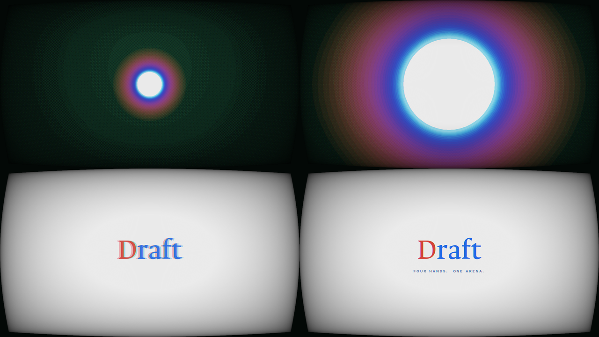
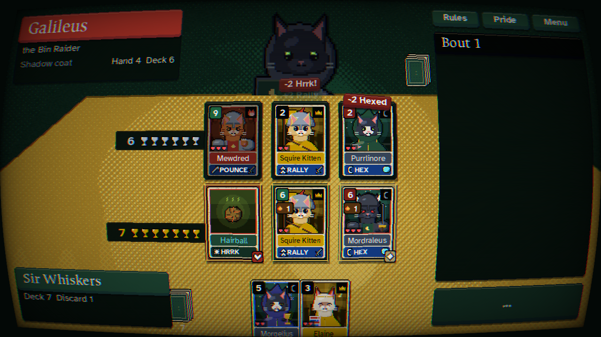
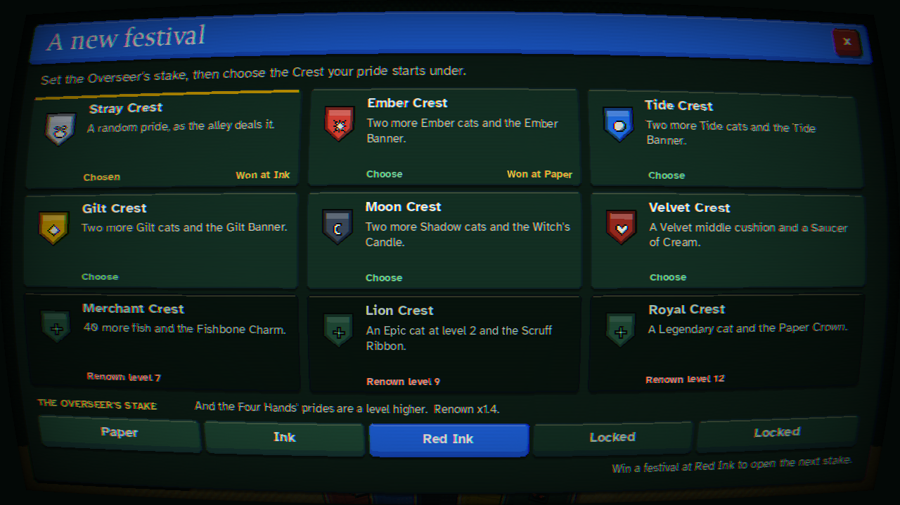

# Draft: Four Hands. One Arena.

A roguelike card game about cat knights, with a nemesis system and the feel of an arena festival. Version 1.0, built in **LÖVE 11 (Lua)**.

- **Story mode, "Stray to Champion".** A nameless stray learns the cushion duel from Old Bedimew (the prologue is the tutorial), then fights through five Arena festivals to dethrone the First Hand. Above them all sits **the Overseer**, a flaming shadow cat who keeps the Arena's ledger; the last chapter is one match at its High Table, where it sees through every card back.
- **Free Festival.** The roguelike: a random pride, 16 cats, four groups, a live points table, then an 8-cat knockout bracket. Pick a **Crest** (a starting loadout) and one of the Overseer's five **Stakes**; winning at your highest stake opens the next.
- **The cushion duel.** Both sides have three cushions; the cats on facing cushions duel, and a winner swats a goblet off the loser's side. Each bout one side **leads** face-down and the other **answers**, seeing only the card backs. A back shows the cat's coat (a flame, a drop, a crown), but Shadow cats and tricks share the same dark back.
- **Hold the Cushion.** A cat that wins its duel stays seated, face-up, and warms up: +1 Paw for every bout it holds on. At 3 Warmth it's a **Hot Seat** and every swat knocks off an extra goblet.
- **Stolen Lives.** Every cat brings 2 or 3 lives into a match. A lost duel costs one; a crushing loss costs two. Out of lives, the rival **captures** the cat. The Four Hands keep your cats across festivals and send them back at you; beat your captive, or beat the Hand, and they come home.
- **Printings.** About one cat in eight comes off the Overseer's press differently: a **Proof** has a life more, **Gold Leaf** earns fish, and a **Misprint** hits harder and shows the wrong coat on its back, so the rival reads it wrong.
- **The Four Hands** are persistent nemesis Warlords. They remember you, hide strengths and weaknesses, scheme between festivals, and build their prides from what they take from you.
- **Renown and Feats.** Every match earns Renown. 27 Feats are stamped into the Overseer's ledger in red ink the moment you earn them. Renown levels give you a title and unlock Crests.
- **Bonds** between legendary pairs, upholstered **cushions**, a rule-bending **omen** for every festival, and **the Cattery**, a collection of every cat you've met.

One look, one sound:

- **A deck printed on the Overseer's press, seen through a CRT.** Everything is drawn on one 640x360 pixel grid: the cats, the cards, the Overseer and a halftone backdrop whose dots swell and shrink in place. Panels, signs and buttons are all cut from the same plate shape; buttons press like keys. Scenes change through an iris with a colour fringe.
- **The teaser opens the game.** The intro replays the teaser in-engine (a lens-ringed orb opening to white, then the red and blue lockup) over the teaser's own music. The soundtrack and every effect are tuned to that music's key, so the bell that climbs as a bout is scored always harmonises with it.
- **Options that a finished game has:** separate music and effect volumes, game speed (1x, 1.5x, 2x), CRT, shake, smooth or pixel text, fullscreen. Pause anywhere. Credits. A crash never closes the game.
- **Readable.** Ancizar Serif headings and Atkinson Hyperlegible text at your screen's real resolution. Every text colour is checked for WCAG AA contrast (4.5:1). Coats read by shape as well as colour.











## Run it

1. Install LÖVE 11.4 or newer from https://love2d.org.
2. From this folder, run:

```bash
love .
```

On Windows you can also drag the folder onto `love.exe`. The teaser plays first; any key skips it, and this starts at the title:

```bash
love . --skip-intro
```

To package a `.love` file:

```bash
tools/build-love.sh
```

| Key | Action |
| --- | --- |
| Click a card | put it on the first free cushion (click it on the cushion to take it back; click a seated cat to pull it back) |
| Drag a card | put it on a particular cushion (drop on a full one to swap) |
| 1 / 2 / 3 | put the card under the mouse on that cushion |
| Enter / Space | Charge! (reveal and duel); continue dialogue |
| Backspace | clear your cushions |
| Arrow keys / W A S D | move through the title menu |
| F11, Alt+Enter, Ctrl+Cmd+F | fullscreen |
| F2 | CRT screen on/off |
| F3 | mute |
| Esc | pause (rules, Cattery, ledger, options) |

A controller works too: the stick moves a paw cursor (the d-pad moves through the main menu), A clicks and drags, X charges, Y clears your cushions, B closes panels, and + opens the menu.

## Nintendo Switch (homebrew)

Draft runs on modded Switch consoles through [LÖVE Potion](https://github.com/lovebrew/lovepotion). There's a shader-free render path with pre-baked art, controller and touchscreen input, and a packer that builds `Draft.nro` from a LÖVE Potion release:

```bash
python3 tools/switch/build.py --lovepotion path/to/lovepotion.nro
```

It can also build an `.nsp` forwarder on your machine with hacBrewPack and keys from your own console. Steps, controls and limits are in [docs/SWITCH.md](docs/SWITCH.md). To try the console code paths on a desktop, run `love . --console`.

## How a match plays

1. You hold 5 cards. The rival leads the first bout: three face-down cards slide onto their cushions.
2. Read their backs. An **Ember** (flame), **Tide** (drop) or **Gilt** (crown) back tells you the cat's coat. A **dark** back (moon) is either a Shadow cat or a trick. A Misprint's back lies.
3. Answer by putting up to 3 cards on your cushions, then press **Charge!**
4. Everything flips over. Each pair of facing cards duels:
   - The higher Paws wins.
   - **Coat edge**: Ember beats Gilt, Gilt beats Tide, Tide beats Ember. The winning coat gets +3 Paws.
   - A cat facing an empty cushion, or a trick, walks in unopposed.
   - Ties go to the leader.
   - Bonded pairs side by side get +2 Paws each, and upholstered cushions add their own twist.
5. Every winner swats a goblet off the loser's side of the table.
6. **Hold the Cushion**: every cat that won its duel stays on its cushion, face-up, with +1 Warmth (+1 Paw per point, up to 5). At 3 Warmth it's a Hot Seat and swats one extra goblet. Everyone else leaves the table. Pull a seated cat back to your hand whenever you like (it loses its Warmth).
7. **Stolen Lives**: the loser of a duel loses a heart (two if it lost by 5 or more). A cat with no hearts left is captured and carried across the table. While you place cards, a red **!** warns you a cat could be captured where it is.
8. Next bout, you lead and the rival answers your backs.

## How a festival plays

1. Choose a **Crest** and a **Stake** (once you've unlocked more than the first of each), and you're dealt a random pride of 15 cats, tilted by the Crest. Stakes add rules for the rivals and multiply your Renown.
2. **Group stage**: 3 matches. A win is worth 3 points, and goblet difference breaks ties. The top 2 of each group go through.
3. **Knockouts**: quarter-final, semi-final, final. Lose once and you're out.
4. Before every match the rival sits down at the table and taunts you. Between matches you visit one stall: the **Mews Market** (cats, charms and the upholsterer), the **Fortune Teller** (random events) or the **Training Yard**.
5. The festival's **omen** applies to every match in it. For example, the Midsummer Sun gives Ember cats +1, and Long Naps gives ties to the side that answers.
6. After the festival, **the Arena moves on**:
   - The festival champion climbs the hierarchy, or takes a seat among the Hands if they were a stray.
   - Slain Hands may return, and recruited Hands may betray you.
   - Hands who beat you train new strengths.

## If something goes wrong

The game catches errors inside a frame instead of closing: it saves your progress, writes the error
to `crash.log` in LÖVE's save folder and takes you back to the menu. Only an error that repeats
four times in three seconds falls through to LÖVE's error screen. If you hit one, `crash.log` is
the file to send.

## Code layout

```
main.lua, conf.lua     boot; renderer (the window is filled at any shape, art on a 640x360 grid, text at screen
                       resolution), scene manager with the iris transition, saves (story, free festival, renown
                       profile), the crash safety net, game speed, the CRT pass
src/audio.lua          music streams with crossfades, effects, the scoring bell on the teaser's scale, volumes
src/platform.lua       desktop LÖVE vs LÖVE Potion (Switch): shader and mouse stand-ins
src/input.lua          mouse, touchscreen and controller folded into one pointer
src/core/              pure game logic, no LÖVE: match engine + AI (lives, captures, Warmth, the Overseer's eye),
                       festival, nemesis, cards (and their printings), traits, charms, run/meta (captives,
                       pawnshop, spoils, crests, stakes), renown (feats, levels, crests, stakes), story, tutorial
src/ui/                the design system: theme (colour roles, the type scale, WCAG contrast, smooth and pixel
                       fonts), plates (the one plate shape, signs), gfx (panels, meters, text), widgets (buttons,
                       tabs, sliders, choice cards, tooltips), print (the living halftone backdrop and table),
                       shaders (the backdrop and the CRT), fx (tags, stamps, shake, punch, pulse), icons,
                       cardview (paper faces, coat glyphs, printings, backs), art (pixel-art cats), overseer,
                       hud, picker, overlays (rules, Cattery, the ledger, new-festival panel, pause...)
src/scenes/            intro (the teaser), menu (title and options), credits, story (chapter map), cutscene,
                       hub, vs, match (with the tutorial and the High Table), result, market, event, summary
src/autotest.lua       scripted walkthrough that saves screenshots: love . --autotest shots
tests/run.lua          rules, Stolen Lives, printings, stakes, Renown, the boss, WCAG contrast and a 90-festival
                       AI simulation: luajit tests/run.lua
assets/                audio (the teaser's music, three loops, 31 effects), fonts (all OFL; see
                       assets/fonts/CREDITS.txt), images from the Figma file and the Overseer's frames;
                       assets/switch holds fallback backdrops for platforms without ImageData
tools/audio/           make_audio.py: renders the soundtrack and effects in the teaser's key
tools/art/             bake_overseer.py: prints the Figma flame cat as the Overseer's pixel halftone frames
tools/switch/          Switch build: bake_assets.py, nro.py (NRO packer), build.py, icon.jpg
```

Design notes, the story script's shape, balance numbers and tuning knobs are in [docs/DESIGN.md](docs/DESIGN.md). Switch homebrew builds are in [docs/SWITCH.md](docs/SWITCH.md).
