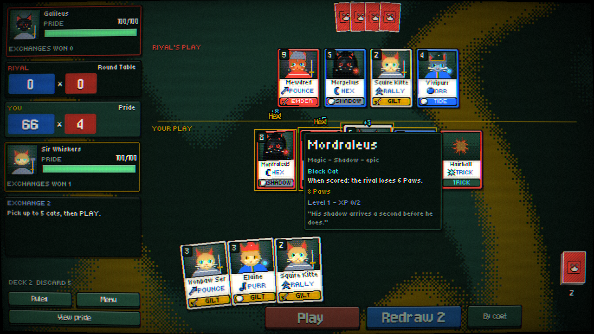

# Draft: Four Hands. One Arena.

A pixel-art roguelike card battler about medieval cats, built in **LÖVE 11 (Lua)**.

- Each run is an **Arena Festival**: 16 cats, four groups of four, a live points table, then an 8-cat knockout bracket.
- Every match is a duel of **Formations**. Pick up to 5 cats, make the best Formation you can, and score **Paws x Cheer**. The higher score knocks Pride off the loser.
- The **Four Hands** are persistent nemesis Warlords. They enter every festival, remember you, hide strengths and weaknesses, and scheme between festivals.



## Run it

1. Install LÖVE 11.4 or newer from https://love2d.org.
2. From this folder, run:

```bash
love .
```

On Windows you can also drag the folder onto `love.exe`. To package a `.love` file:

```bash
tools/build-love.sh
```

| Key | Action |
| --- | --- |
| Click cards | select up to 5 |
| Enter / Space | play the selection |
| R | redraw the selected cards |
| S | sort the hand by coat or by Paws |
| F11 / Alt+Enter | fullscreen |
| F2 | CRT: subtle curve / flat / off |
| F3 | sound on/off |
| Esc | menu |

## How a festival plays

1. You're dealt a random pride of 15 cats. There's no draft.
2. **Group stage**: 3 matches. A win is worth 3 points, and Pride difference breaks ties. The top 2 of each group go through.
3. **Knockouts**: quarter-final, semi-final, final. Lose once and you're out.
4. Before every match there's a **VS screen**. Between matches you visit one stall: the **Mews Market**, the **Fortune Teller** (random events) or the **Training Yard**.
5. After the festival, **the Arena moves on**:
   - The festival champion climbs the hierarchy, or takes a seat among the Hands if they were a stray.
   - Slain Hands may return, and recruited Hands may betray you.
   - Hands who beat you train new strengths.

## Code layout

```
main.lua, conf.lua     boot, 640x360 virtual canvas (rendered 2x), scene manager, CRT pass, input
src/core/              pure game logic, no LÖVE: formations, match engine + AI, festival, nemesis, cards, traits, charms, run/meta
src/ui/                theme (palette, fonts), gfx (pixel panels/text), icons (ASCII pixel sprites), cardview, art (dithered cats),
                       shaders (CRT, swirl, foil, dissolve, dither, bake), widgets, fx, sfx, hud, picker, overlays
src/scenes/            title, hub (festival grounds), vs, match, result, market, event (fortune teller), summary
src/autotest.lua       scripted walkthrough that saves screenshots: love . --autotest shots
tests/run.lua          engine tests + 90-festival AI simulation: luajit tests/run.lua
assets/                pixel fonts (OFL) and images from the Figma file
```

To tweak the look, start with `src/ui/theme.lua` (palette, type scale), `src/ui/gfx.lua` (panel/button style), and the CRT block in `src/ui/shaders.lua`. Design notes and balance knobs are in [docs/DESIGN.md](docs/DESIGN.md).
