# Draft — Four Hands. One Arena.

A roguelike deck-drafting card battler about medieval cats. The duels play like Gwent: best of three rounds, with a hand that carries over between rounds. Cats come in coats with type advantages and level up as you play them, Pokémon-style. A nemesis system in the spirit of Shadow of War makes the Arena's Warlords remember you, grow, scheme and come back.



## Play

```bash
npm install
npm run dev      # http://localhost:5173
```

```bash
npm run build    # static site in dist/ (open with any static server)
npm test         # engine tests + 180-run AI simulation
```

Progress is saved in `localStorage`, so the Four Hands and their memories persist between sessions.

## What's in the game

- **Draft** a pride of 10 cats (pick 1 of 3), plus a few basics.
- **Climb four rings.** Each ring has two stops (Skirmish, the Pit, Mews Market, a Shrine event, or the Sleeping Fox inn) and ends with a **Warlord**.
- **Nine lives.** Losing a skirmish costs 2 lives, and losing to a Warlord costs 3.
- **Duels.** Physical cats fight in the Vanguard, Magic cats in the Arcane row. Win 2 of 3 rounds. Abilities include Sword Hammer (smite), Aural Orb (inspire), Black Cat (hex), Litter, Pounce, Nine Lives, Stray, Groom, Purr, War Yowl and Call the Pride. Specials are Downpour, Moonfog, Sunbeam, Rallying Yowl, Cardboard Box and Hairball.
- **Coats.** Ember > Gilt > Tide > Ember gives +2 in a row. Shadow cats are the Black Cats.
- **Growth.** Cats you play in won duels gain XP and become Knights (★) and then Paladins (★★).
- **Charms.** Thirteen passive relics, with up to 5 carried at once.
- **The Four Hands (nemesis system):**
  - Persistent Warlords with procedural names, coats, personalities, portraits and hidden **strengths and weaknesses**.
  - Traits are revealed when they trigger in a duel, by interrogating strays you beat, by bribing a rat, or by carrying a Spyglass.
  - A Warlord who beats you levels up, gains a **Grudge**, becomes "Bane of *you*", and trains a new strength between runs.
  - A stray who beats you can get **promoted** into the Hands and kick out the lowest one.
  - After beating a Warlord you choose its fate. **Slay** it, though it may return "the Returned" with scars. **Recruit** it after a flawless 2–0: it becomes a Legendary card, but may betray you next run. **Brand** it to give it a weakness and a grudge.
  - Between runs **the Arena moves on**: power struggles, returns from the dead, betrayals, new blood. You can also *sow discord* or *poison a Warlord's supper* through shrine events.
  - Dialogue reacts to your shared history: first meeting, they beat you, you scarred them, they came back from the dead, they betrayed you.

## Project layout

```
src/core/        pure game logic (no DOM): duel engine, AI, cards, traits, nemesis, run/meta
src/ui/          DOM screens, dithered procedural portraits, sfx
src/assets/      SVGs exported from the Figma file (logo, tagline, mascot, shadow, badge)
tests/           engine unit tests and a full-run AI simulation
docs/DESIGN.md   design notes, Figma mapping, balance numbers, roadmap
```

See [docs/DESIGN.md](docs/DESIGN.md) for details.
