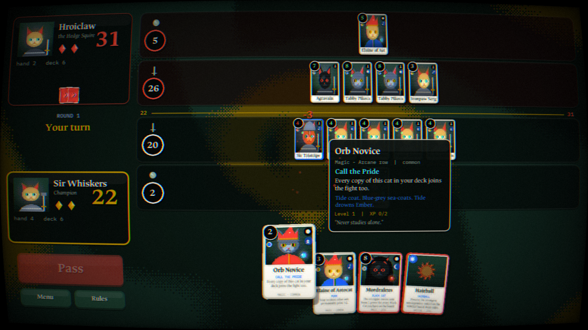

# Draft: Four Hands. One Arena.

A roguelike deck-drafting card battler about medieval cats, built in **LÖVE 11 (Lua)**.

- Duels play like Gwent: best of three rounds, two rows, and a hand that carries over.
- Cats have Pokémon-style coats with type advantages, and they level up as you play them.
- The Four Hands are a Shadow of War-style nemesis council that persists between runs.
- Everything is shown through a CRT post-process with a dithered pixel-art look.



## Run it

1. Install LÖVE 11.4 or newer from https://love2d.org.
2. From this folder, run:

```bash
love .
```

On Windows you can also drag the folder onto `love.exe`, or run:

```bash
"C:\Program Files\LOVE\love.exe" .
```

To package a `.love` file:

```bash
tools/build-love.sh
```

| Key | Action |
| --- | --- |
| F11 / Alt+Enter | fullscreen |
| F2 | CRT filter on/off |
| F3 | sound on/off |
| Esc | menu |
| Space / P | pass (in a duel) |

## Presentation

All of these effects are original code:

- **CRT post-process** (`src/ui/shaders.lua`): barrel curvature, RGB split, bloom, scanlines, aperture mask, vignette, grain and flicker.
- **Animated swirl background**, pixel-quantized and Bayer-dithered. Its palette changes per scene: green on the map, gold in the market, red for Warlords.
- **Cards** (`src/ui/cardview.lua`):
  - Spring physics, idle sway, and lean on movement.
  - Pseudo-3D tilt toward the mouse, done with a perspective-projected mesh.
  - Holographic foil on Legendaries.
  - A white flash when a card is played, and a noise dissolve when a card is destroyed.
- **Juice** (`src/ui/fx.lua`): particles, screen shake, pop-in floating numbers, wavy titles, round banners, ticking score counters, and dithered scene wipes.
- **Synthesized audio** (`src/ui/sfx.lua`): every sound effect plus an ambient loop is generated at startup, so there are no audio files.
- **Procedural dithered cat portraits** (`src/ui/art.lua`): each one is drawn with primitives, then ordered-dithered to the Figma palette on the GPU.
- **Figma assets**: the logo, mascot, shadow creature and badge are rasterized from your Figma file. The font is Ancizar Serif (OFL).

## Layout

```
main.lua, conf.lua     boot, scene manager, CRT pass, input
src/core/              pure game logic (no LÖVE): duel engine, AI, cards, traits, nemesis, run/meta
src/ui/                shaders, card views, widgets, fx, art, sfx, HUD, overlays
src/scenes/            title, draft, map, encounter, duel, reward, market, event, summary
src/autotest.lua       scripted walkthrough that saves screenshots (love . --autotest shots)
tests/run.lua          engine tests + 120-run AI simulation (luajit tests/run.lua)
assets/                fonts and Figma-exported images
```

See [docs/DESIGN.md](docs/DESIGN.md) for the rules, the nemesis system and the tuning knobs.
