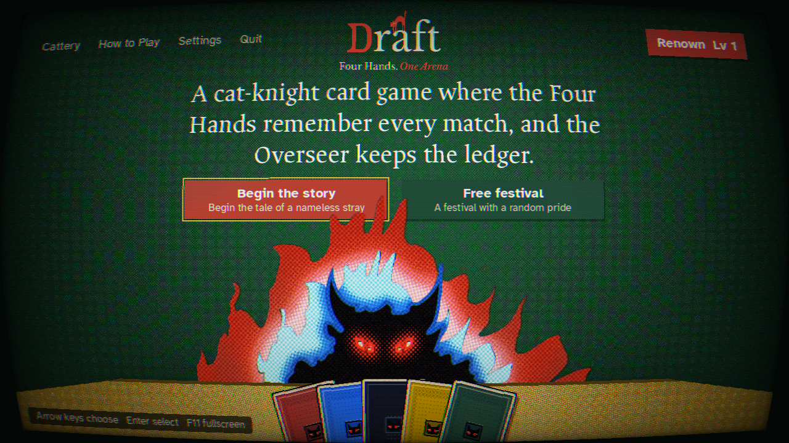
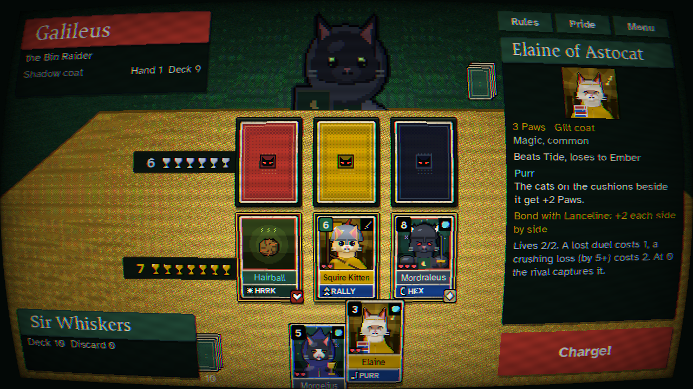
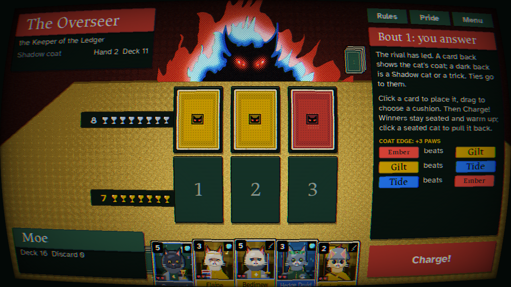
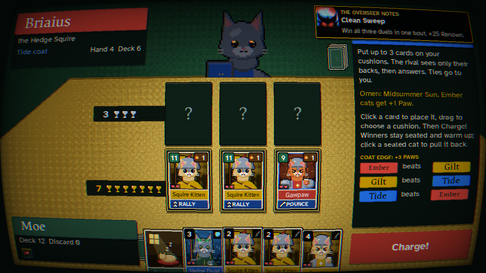
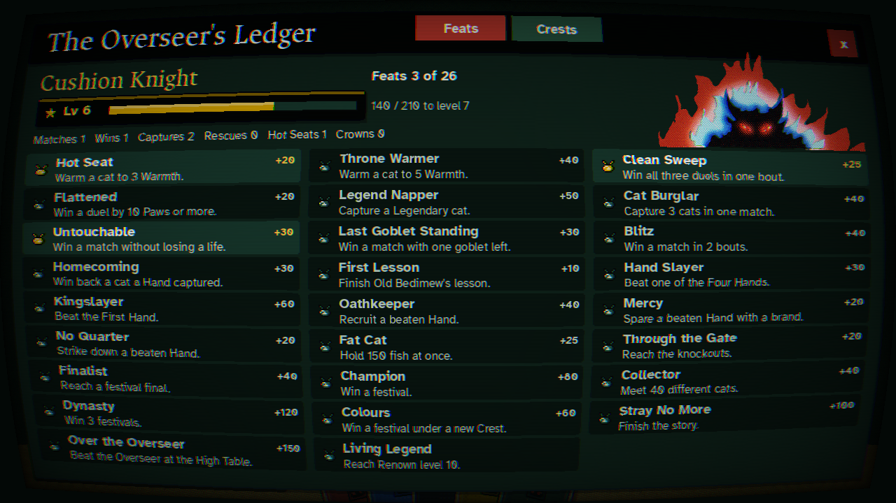
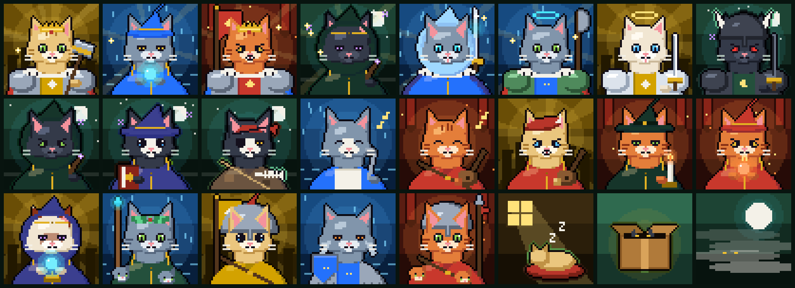
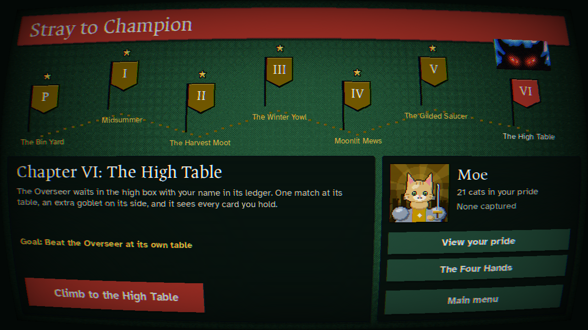
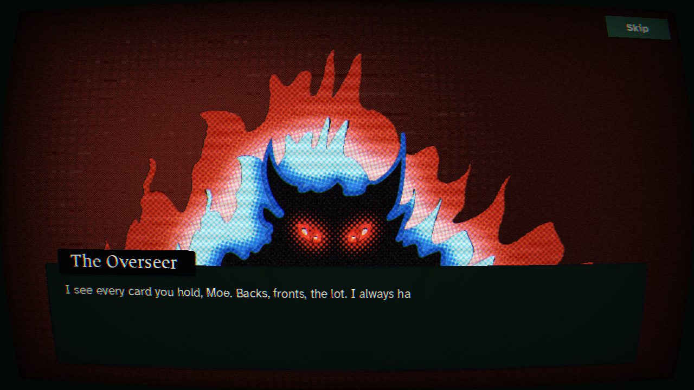

# Draft: Four Hands. One Arena.

A pixel-art roguelike card game about cat knights, with a nemesis system and the feel of an arena festival. Built in **LÖVE 11 (Lua)**.

- **Story mode, "Stray to Champion".** A nameless stray learns the cushion duel from Old Bedimew (the prologue is the tutorial), then fights through five Arena festivals to dethrone the First Hand. Each chapter is a full festival with a goal and cutscenes. Above them all sits **the Overseer**, a flaming shadow cat who keeps the Arena's ledger; the last chapter is one match at its High Table, where it sees through every card back.
- **Free Festival.** The roguelike: a random pride, 16 cats, four groups, a live points table, then an 8-cat knockout bracket.
- **The cushion duel.** Both sides have three cushions; the cats on facing cushions duel, and a winner swats a goblet off the loser's side. Each bout one side **leads** face-down and the other **answers**, seeing only the card backs. A back shows the cat's coat, but Shadow cats and tricks share the same dark back.
- **Hold the Cushion.** A cat that wins its duel stays seated, face-up, and warms up: +1 Paw for every bout it holds on. At 3 Warmth it's a **Hot Seat** and every swat knocks off an extra goblet. Keep a streak going, or pull a cat back before the rival aims at it.
- **Stolen Lives.** Every cat brings 2 or 3 lives (hearts) into a match. A lost duel costs one; a crushing loss (by 5+ Paws) costs two. Out of lives, the rival **captures** the cat. The Four Hands keep your captured cats across festivals and send them back at you, marked as yours; beat your captive, or beat the Hand, and they come home. Strays pawn theirs at the market. The rival cats you capture are your spoils.
- **The Four Hands** are persistent nemesis Warlords. They remember you, hide strengths and weaknesses, scheme between festivals, and build their prides from what they take from you.
- **Renown and Feats.** Every match in either mode earns Renown, and 26 Feats (a Hot Seat, a Clean Sweep, a Legend Napper, a Kingslayer...) are noted by the Overseer the moment you earn them. Renown levels give you a title and unlock **Crests**, starting loadouts for a Free Festival.
- **Bonds** between legendary pairs, upholstered **cushions**, a rule-bending **omen** for every festival, and **the Cattery**, a collection of every cat you've met.
- **A printed poster look.** Film-grain dark green with halftone light, a mustard halftone table under every match, flat red buttons, serif headings and sans text. The Overseer is a halftone print with flickering flames, looming over the menu's table. Cards are printed on worn cream paper, and every card back carries the Overseer's mark. Every cat is a hand-composed pixel bust.
- **A CRT screen** (on by default; Settings or F2 turns it off): gentle curvature, scanlines, bloom and a colour fringe.
- **Readable.** Ancizar Serif headings and Atkinson Hyperlegible text at your screen's real resolution (Settings > Text switches to pixel fonts on the art's grid). Every text colour is checked for WCAG AA contrast (4.5:1). Fullscreen fills any screen shape, Macs included, with no black bars.

















## Run it

1. Install LÖVE 11.4 or newer from https://love2d.org.
2. From this folder, run:

```bash
love .
```

On Windows you can also drag the folder onto `love.exe`. To package a `.love` file:

```bash
tools/build-love.sh
```

| Key | Action |
| --- | --- |
| Click a card | put it on the first free cushion (click it on the cushion to take it back; click a seated cat to pull it back) |
| Drag a card | put it on a particular cushion (drop on a full one to swap) |
| 1 / 2 / 3 | put the card under the mouse on that cushion |
| Enter / Space | Charge! (reveal and duel); continue dialogue |
| Backspace | clear your cushions |
| Arrow keys / W S | move through the main menu |
| F11, Alt+Enter, Ctrl+Cmd+F | fullscreen |
| F2 | CRT screen on/off |
| F3 | sound on/off |
| Esc | menu |

A controller works too: the stick moves a paw cursor (the d-pad moves through the main menu), A clicks and drags, X charges, Y clears your cushions, B closes panels, and + opens the menu.

## Nintendo Switch (homebrew)

Draft runs on modded Switch consoles through [LÖVE Potion](https://github.com/lovebrew/lovepotion). There's a shader-free render path with pre-baked art, controller and touchscreen input, and a packer that builds `Draft.nro` from a LÖVE Potion release:

```bash
python3 tools/switch/build.py --lovepotion path/to/lovepotion.nro
```

It can also build an `.nsp` forwarder on your machine with hacBrewPack and keys from your own console. Steps, controls and limits are in [docs/SWITCH.md](docs/SWITCH.md). To try the console code paths on a desktop, run `love . --console`.

## How a match plays

1. You hold 5 cards. The rival leads the first bout: three face-down cards slide onto their cushions.
2. Read their backs. An **Ember**, **Tide** or **Gilt** back tells you the cat's coat. A **dark** back is either a Shadow cat or a trick.
3. Answer by putting up to 3 cards on your cushions, then press **Charge!**
4. Everything flips over. Each pair of facing cards duels:
   - The higher Paws wins.
   - **Coat edge**: Ember beats Gilt, Gilt beats Tide, Tide beats Ember. The winning coat gets +3 Paws.
   - A cat facing an empty cushion, or a trick, walks in unopposed.
   - Ties go to the leader.
   - Bonded pairs side by side get +2 Paws each, and upholstered cushions add their own twist.
5. Every winner swats a goblet off the loser's side of the table.
6. **Hold the Cushion**: every cat that won its duel stays on its cushion, face-up, with +1 Warmth (+1 Paw per point, up to 5). At 3 Warmth it's a Hot Seat and swats one extra goblet. Everyone else leaves the table. Pull a seated cat back to your hand whenever you like (it loses its Warmth).
7. **Stolen Lives**: the loser of a duel loses a heart (two if it lost by 5 or more). A cat with no hearts left is captured and carried across the table. While you place cards, a red **!** warns you a cat could be captured where it is.
8. Next bout, you lead and the rival answers your backs.

## How a festival plays

1. Choose a **Crest** (once you've unlocked more than the Stray Crest), and you're dealt a random pride of 15 cats, tilted by the Crest.
2. **Group stage**: 3 matches. A win is worth 3 points, and goblet difference breaks ties. The top 2 of each group go through.
3. **Knockouts**: quarter-final, semi-final, final. Lose once and you're out.
4. Before every match the rival sits down at the table and taunts you. Between matches you visit one stall: the **Mews Market** (cats, charms and the upholsterer), the **Fortune Teller** (random events) or the **Training Yard**.
5. The festival's **omen** applies to every match in it. For example, the Midsummer Sun gives Ember cats +1, and Long Naps gives ties to the side that answers.
6. After the festival, **the Arena moves on**:
   - The festival champion climbs the hierarchy, or takes a seat among the Hands if they were a stray.
   - Slain Hands may return, and recruited Hands may betray you.
   - Hands who beat you train new strengths.

## If something goes wrong

The game catches errors inside a frame instead of closing: it saves your progress, writes the error
to `crash.log` in LÖVE's save folder and takes you back to the menu. Only an error that repeats
four times in three seconds falls through to LÖVE's error screen. If you hit one, `crash.log` is
the file to send.

## Code layout

```
main.lua, conf.lua     boot; renderer (the window is filled at any shape, art on a 640x360 grid, text at screen
                       resolution), scene manager, saves (story, free festival, renown profile), the crash safety net, the CRT pass
src/platform.lua       desktop LÖVE vs LÖVE Potion (Switch): shader and mouse stand-ins
src/input.lua          mouse, touchscreen and controller folded into one pointer
src/core/              pure game logic, no LÖVE: match engine + AI (lives and captures), festival, nemesis,
                       cards, traits, charms, run/meta (captives, pawnshop, spoils, crests), renown (feats, levels,
                       crests), story, tutorial
src/ui/                theme (palette, WCAG contrast, smooth and pixel fonts), plates (flat plates and title cards),
                       gfx (panels, text), icons, cardview (paper faces with live text and hearts, ornate backs),
                       print (the baked halftone backdrops and table), overseer (its frames, blinks and face),
                       art (pixel-art cats),
                       shaders (the CRT), widgets, fx (with the Overseer's notes), sfx, hud, picker,
                       overlays (rules, Cattery, Renown, Crest picker...)
src/scenes/            menu, story (chapter map), cutscene, hub, vs, match (with the tutorial), result, market,
                       event, summary
src/autotest.lua       scripted walkthrough that saves screenshots: love . --autotest shots
tests/run.lua          rules, Stolen Lives, Renown, WCAG contrast and a 90-festival AI simulation: luajit tests/run.lua
assets/                fonts (all OFL: Fusion Pixel, Coral Pixels, Jacquard 12, Jersey 15, Micro 5, Atkinson
                       Hyperlegible, Ancizar Serif; see assets/fonts/CREDITS.txt) and images from the Figma file;
                       assets/switch holds the baked backdrop and smear art
tools/switch/          Switch build: bake_assets.py, nro.py (NRO packer), build.py, icon.jpg
tools/art/             bake_overseer.py: prints the Figma flame cat as the Overseer's halftone frames
```

Design notes, the story script's shape, balance numbers and tuning knobs are in [docs/DESIGN.md](docs/DESIGN.md). Switch homebrew builds are in [docs/SWITCH.md](docs/SWITCH.md).
